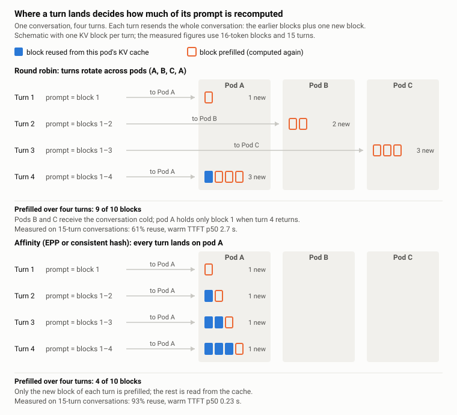
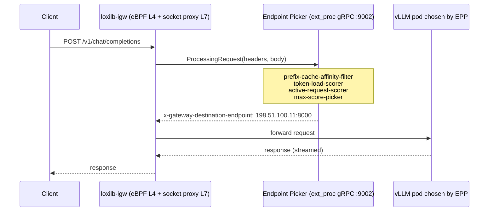
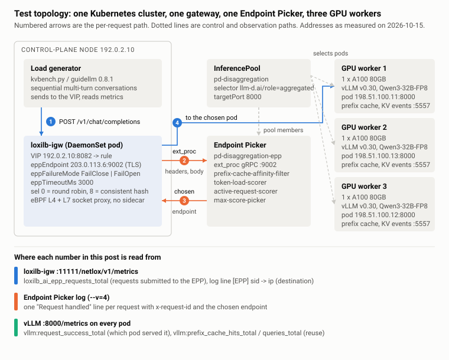
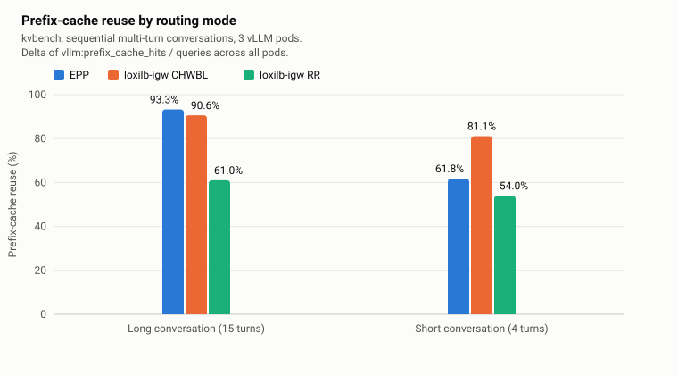
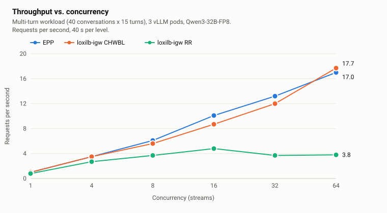
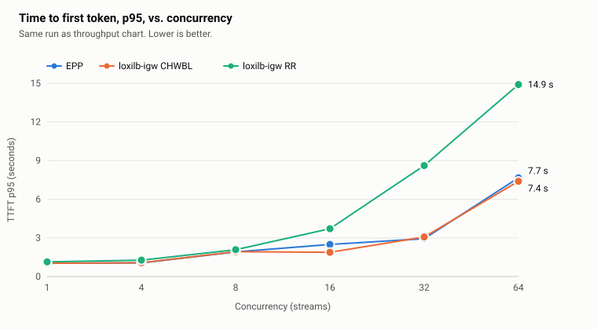

# Measuring LLM Request Routing: Endpoint Picker vs. Consistent Hashing vs. Round Robin

What was measured when loxilb-igw asked the Endpoint Picker where each request should go, against the same gateway running consistent hashing and round robin: cache reuse, time to first token, throughput and failure behaviour.

<!-- example-status-default: illustrative-only -->

## Before you start

Read this as the record of one set of measurements on the topology this family builds, not as a method for your own fleet; for that see [Performance Measurement](../performance-methodology.md). Addresses in this page, in the retained logs and in the captured objects were rewritten one-to-one to documentation ranges: the gateway VIP `192.0.2.10`, the three pods `198.51.100.11`, `.12`, `.13`, the EPP ClusterIP `203.0.113.6`, the second cluster's VIP `192.0.2.11` and pods `198.51.100.21` to `.25`. Node names were rewritten to `gpu-node-1` to `gpu-node-3`. Nothing else in the data was changed.

**Focus of this page:** Routing policy decides whether the KV cache gets used at all.

## Topology and execution locations

--8<-- "snippets/use-cases/topology/endpoint-picker.md"

| Where | What happens here |
|---|---|
| Operator shell (the control-plane node in this guide) | `kubectl`, `curl` against the gateway's REST API on `:11111`, the harness, pod `:8000/metrics` reads |
| Client | sends OpenAI-style requests to the gateway VIP, `192.0.2.10:8080` |
| loxilb-igw (DaemonSet, hostNetwork on the control-plane node) | holds the rule, asks the EPP per request, forwards to the pod it names |
| Endpoint Picker (Deployment + ClusterIP Service) | watches the `InferencePool`, keeps the prefix-cache index, answers over ext_proc gRPC `:9002` |
| vLLM pods (one per GPU node) | serve the model on `:8000`; their metrics are the independent attribution of which pod served a request |

## Reading path and reference

Load balancing LLM traffic is not like load balancing web traffic. A request that lands on a pod that already holds the conversation's KV cache finishes in a fraction of the time it takes on a pod that has to recompute the prefix. The Gateway API Inference Extension (GIE) addresses this with an **Endpoint Picker (EPP)**: an out-of-process scheduler the gateway consults per request.

We implemented the EPP protocol in [loxilb-igw](https://github.com/loxilb-io/loxilb-inference-gateway), the loxilb inference gateway, an AI-specialized gateway built on the eBPF data plane of [loxilb](https://github.com/loxilb-io/loxilb), and then measured what the EPP actually buys you compared with two things the gateway can do on its own: consistent-hash session affinity (CHWBL) and plain round robin (RR).

Routing policy decides whether the KV cache gets used at all, any affinity recovers most of what round robin throws away, and the EPP builds that affinity from the prompt itself instead of from a hash of its opening. This post is the measurement record behind that sentence: what we ran, what we saw, and how to run it yourself. Every table is backed by logs and metrics in the companion repository: [loxilb-io/loxilb-inference-gateway](https://github.com/loxilb-io/loxilb-inference-gateway).

### Why round robin hurts LLM serving

vLLM keeps the KV cache of recently processed prompt prefixes on the GPU, in fixed-size blocks (16 tokens here). When the next turn of the same conversation arrives at the **same pod**, the shared prefix is looked up instead of recomputed. When it arrives at a **different pod**, the whole prefix is prefilled again.



Under round robin the receiving pod rarely holds the conversation's prefix, so most of each prompt is prefilled again. Under affinity the conversation stays on one pod and only the new turn is prefilled. Measured on the real workload, 40 conversations x 15 turns on 3 vLLM pods with Qwen3-32B-FP8 (kvbench, 2026-10-16):

| Metric | EPP | loxilb-igw CHWBL | loxilb-igw RR |
|---|---|---|---|
| Prefix-cache reuse | **93.3%** | 90.6% | 61.0% |
| Warm TTFT p50 | **232 ms** | 246 ms | 2,696 ms |
| Warm TTFT p95 | **395 ms** | 2,661 ms | 7,804 ms |
| Errors (600 requests) | 0 | 0 | 0 |

Round robin recomputes 39% of prefix blocks and pays for it with a warm first token that arrives more than ten times later. The rest of this post is about where that gap comes from, how to close it, and which of the two ways of closing it you need.

A gateway has two ways to avoid this:

- **Guess** where the prefix is, by hashing the leading bytes of the prompt (the system prompt and model name, at the default level) onto a consistent-hash ring. Turns of one conversation share that opening, so they hash to the same pod. That is loxilb-igw's CHWBL selector.
- **Ask** a component that knows, per request, which pod holds the prefix and how loaded each pod is. That is the Endpoint Picker.

### Where the Endpoint Picker sits, and where loxilb-igw sits

GIE defines an `InferencePool` (the set of model-server pods) and an Endpoint Picker service attached to it. The gateway data plane calls the EPP over Envoy's external-processing protocol (`ext_proc`, gRPC bidirectional streaming) with the request headers and body. The EPP inspects the prompt, runs its scheduling plugins, and returns the chosen pod in a response header. The gateway then forwards the original request to that pod.



Most gateways that implement GIE are built on Envoy. loxilb-igw is not: it inherits loxilb's eBPF L4 data plane and adds an L7 socket proxy for AI-aware rules, in a single binary with no sidecar. We implemented the EPP protocol in that proxy, so an `InferencePool`'s EPP can be attached to any loxilb-igw load-balancer rule.

#### The rule

An EPP is attached per rule, with three fields. `eppEndpoint` is the EPP service's ClusterIP and ext_proc port. `eppFailureMode` mirrors the `InferencePool.spec.endpointPickerRef.failureMode` semantics: `FailClose` answers 503 when the EPP cannot be reached, `FailOpen` falls back to the rule's own selector. `eppTimeoutMs` bounds the wait for an EPP answer, measured from submission and including the connection to the EPP. The rule used throughout this post, and how to create it by hand or through kube-loxilb, is in the [EPP deployment guide](rule.md).

The rule's own selector (`sel: 0` round robin, `sel: 8` CHWBL) is what the request would have used **without** an EPP. In the measurements below, "loxilb-igw RR" and "loxilb-igw CHWBL" are loxilb-igw running the same rule with `eppEndpoint` removed.

### Test environment

All numbers in this post come from two clusters measured on 2026-10-15, 2026-10-16 and 2026-10-20. Each cluster has the same shape: one control-plane node running the load generator and loxilb-igw, one Endpoint Picker, and GPU workers with one vLLM pod each.



Versions as recorded at measurement time:

| Component | Version / configuration |
|---|---|
| Kubernetes | v1.36.4+rke2r1 (RKE2), Calico |
| GPU workers | 3 x NVIDIA A100 80GB PCIe, one GPU per vLLM pod |
| vLLM | `vllm/vllm-openai:v0.30.0`, `Qwen/Qwen3-32B-FP8`, TP=1, `--block-size=16 --prefix-caching-hash-algo=sha256_cbor`, KV events over ZMQ |
| Endpoint Picker | `ghcr.io/llm-d/llm-d-router-endpoint-picker:main`, `InferencePool` API `inference.networking.k8s.io/v1` |
| EPP scheduling profile | `prefix-cache-affinity-filter`, `token-load-scorer`, `active-request-scorer`, `max-score-picker` (producers: `approx-prefix-cache-producer`, `inflight-load-producer`) |
| loxilb-igw | latest [loxilb-inference-gateway](https://github.com/loxilb-io/loxilb-inference-gateway), deployed as in the [EPP deployment guide](index.md) |
| Load tools | `kvbench.py` (a sequential multi-turn client, in the [results archive](../../assets/endpoint-picker/epp-measurements-2026-10.tgz)) and [guidellm](https://github.com/vllm-project/guidellm) 0.8.1 with the Qwen tokenizer |

Clients ran on the control-plane node and sent to the loxilb-igw VIP. Pod attribution for every request came from the per-pod `vllm:request_success_total` counter, which does not depend on the routing mode under test.

### Step 1: Every request goes through the EPP, 200 of 200

**What this step shows.** The sequence diagram is a claim about the data path: loxilb-igw asks the EPP about every request and forwards each one to the endpoint the EPP names. Every number later in this post assumes that claim, so Step 1 checks it per request, from four observation points that share no code.

**Setup.** The rule above, with the EPP's log level raised to `--v=4`. The llm-d chart deploys the EPP at `--v=2`, which logs startup and errors; at `--v=4` it writes one JSON line per request, `Request handled`, carrying the request's `x-request-id` and the endpoint it chose, and Step 3 reads the scheduler's per-candidate scores at the same level. Both are the guide's [smoke test](smoke-test.md), which ends with one request visible at the four points this step counts.

**Run.** 200 sequential requests, each with its own `x-request-id` and a unique prompt. The loxilb-igw counter was read before and after, and both logs were collected for the window. In the harness this is `run.sh verify-path`.

**The four counts.**

| Observation point | What it is | Count |
|---|---|---|
| Client | `sent.txt`, one line per request with its HTTP status | 200 sent, 200 HTTP 200 |
| loxilb-igw metric | `loxilb_ai_epp_requests_total` from the REST `/metrics` endpoint; incremented once per request submitted to the EPP | 346 to 546, +200 |
| loxilb-igw log | one `[EPP] ... sid=N -> ip:port` line per request, written when the proxy connects to the endpoint the EPP returned | 200 |
| EPP log | one `Request handled` JSON line per request | 200 |

Three of these points also name a pod per request: the EPP log says which endpoint it chose, the loxilb-igw log says which endpoint it connected to, and each vLLM pod's `vllm:request_success_total` counter says which pod served the request. If anything between the EPP and the pod changed the decision, the three distributions would differ. They did not:

| Pod | EPP decisions (`endpoint` field) | loxilb-igw connections (address after `->`) | vLLM `request_success_total` delta |
|---|---|---|---|
| 198.51.100.13 | 67 | 67 | 67 |
| 198.51.100.11 | 59 | 59 | 59 |
| 198.51.100.12 | 74 | 74 | 74 |

Equal distributions could still hide swapped pairs, so the last check is per request. The EPP line carries the `x-request-id`. The loxilb-igw line carries `sid`, the proxy's session number, which increases in accept order, and the sends were sequential. Pairing the two logs in order gives **200 of 200** requests forwarded to exactly the endpoint the EPP returned. The saved logs and the `join.py` that pairs them are in the [results archive](../../assets/endpoint-picker/epp-measurements-2026-10.tgz) under `results/phase1/`. One pair:

```json
{"timestamp":"2026-10-15T03:08:20.447Z","caller":"requestcontrol/director.go:508",
 "body":"Request handled","x-request-id":"vrfy-0001","endpoint":"198.51.100.11:8000"}
```
```
03:08:20 INFO sockproxy_ep.c:855: [EPP] fd=756 sid=347 -> 198.51.100.11:8000 (ep2, candidate 1 of 1)
```

In the loxilb-igw line, `ep2` is that endpoint's index in the rule and `candidate 1 of 1` says the EPP returned a single candidate and the proxy took it.

### Step 2: The EPP decides, the gateway follows

**What this step shows.** Step 1 shows that the EPP's choices and loxilb-igw's destinations agree. It does not show which side made the choice. A gateway that consulted the EPP, discarded the answer and ran its own round robin over the same three pods would produce matching counts whenever the two spreads happened to coincide. Step 2 sets the EPP and loxilb-igw's own selector up to disagree, then checks which one wins.

**Setup.** Two knobs, changed independently of each other:

- **The EPP's view of the pool.** The EPP picks from the pods matched by the `InferencePool` selector. We labeled one pod and pointed the selector at that label, so the EPP could return only that pod.
- **loxilb-igw's rule.** Unchanged: all three endpoints, `eppEndpoint` set, and its own selector first `sel: 0` (round robin), then `sel: 8` (CHWBL).

```bash
kubectl -n $NS label pod <pod with IP 198.51.100.11> vrfy-pin=A
kubectl -n $NS patch inferencepool pd-disaggregation --type=json \
  -p '[{"op":"replace","path":"/spec/selector/matchLabels","value":{"vrfy-pin":"A"}}]'
```

Which pod served each request was read from the pod side, independently of both logs. Before each request we snapshot every pod's `vllm:request_success_total`; after it, the pod whose counter rose by one served it:

```bash
succ(){ curl -s http://$1:8000/metrics | awk '/^vllm:request_success_total/{s+=$NF} END{print s+0}'; }
```

**Result.** With the EPP able to name only 198.51.100.11, the rule's own selector made no difference:

| loxilb-igw selector | Requests | Destination (from pod counters) | EPP log |
|---|---|---|---|
| `sel: 0` (round robin) | 60 | 60/60 to 198.51.100.11 | `Request handled` 60, all 198.51.100.11 |
| `sel: 8` (CHWBL) | 40 | 40/40 to 198.51.100.11 | `Request handled` 40, all 198.51.100.11 |

**Head to head on the same rule.** The pool restriction shows the gateway follows the EPP; a second run shows it against what the gateway would have done alone. Same rule with `sel: 0` and three endpoints, 12 requests **without** `eppEndpoint`, then the pool pinned to P1 and the same 12 requests with `eppEndpoint` added:

| Position | RR alone (rule without `eppEndpoint`) | EPP on (same rule, EPP returns P1) | Same pod? |
|---|---|---|---|
| 1 | P1 | P1 | yes |
| 2 | P2 | P1 | no |
| 3 | P3 | P1 | no |
| 4 | P1 | P1 | yes |
| 5 | P2 | P1 | no |
| 6 | P3 | P1 | no |
| 7 | P1 | P1 | yes |
| 8 | P2 | P1 | no |
| 9 | P3 | P1 | no |
| 10 | P1 | P1 | yes |
| 11 | P2 | P1 | no |
| 12 | P3 | P1 | no |

Round robin alone cycles through the three pods. With the EPP attached, 8 of 12 positions went to a different pod than round robin would have chosen, and the other 4 coincided. loxilb-igw's log for the EPP run shows 12 of 12 forwards to P1 (198.51.100.12).

Restoring the pool afterwards is the reverse patch (`{"llm-d.ai/guide":"pd-disaggregation"}`) and removing the label.

The forwarding decision comes from the EPP's candidate list. The rule's selector is consulted only when there is no EPP answer to follow, which is the `FailOpen` path shown later.

### Step 3: A prefix goes from cold to warm in one turn

**What this step shows.** How the EPP produces affinity without a key from the client. One conversation, five turns, and for each turn three readings: how many pods the EPP still considers and how it scores them, which pod vLLM reports serving, and how much of that request's prompt the pod found in its prefix cache.

**Setup.**

- **EPP at `--v=4`**, as in Step 1. At this level the scheduler logs, per request, `Selecting endpoints from candidates sorted by max score` with `num-of-candidates` and the scored list (address and score), plus one `Calculated score` line per plugin per candidate.
- **The same FailClose rule** with three endpoints.
- **The conversation.** A document of 200 generated sentences carrying a random nonce, so no pod can hold any of it before turn 1. Turn `t` appends one question line and resends the whole accumulated text as the prompt, the way a chat client resends its history. `temperature: 0`, `max_tokens: 16`.
- **Per-turn attribution from the pod side.** Before each turn, snapshot every pod's `vllm:request_success_total`, `vllm:prefix_cache_queries_total` and `vllm:prefix_cache_hits_total`. After the turn, the pod whose success counter rose is the server, and its hits delta over its queries delta is the prefix-cache hit rate for that one request.

**Result.** The `Selecting endpoints` line of each turn gives the candidate count and the scores; the pod counters give the serving pod and its hit rate. The script is in `scripts/` in the [results archive](../../assets/endpoint-picker/epp-measurements-2026-10.tgz).

| Turn | EPP candidates | Scores | Chosen pod | Prefix-cache hit rate (vLLM) |
|---|---|---|---|---|
| 1 (cold) | 3 | 1.9991, 1.9991, 1.9991 (tie) | 198.51.100.13 | 0.0% |
| 2 | 1 | 2.0 | 198.51.100.13 | 99.7% |
| 3 | 1 | 2.0 | 198.51.100.13 | 99.8% |
| 4 | 1 | 2.0 | 198.51.100.13 | 99.9% |
| 5 | 1 | 2.0 | 198.51.100.13 | 100.0% |

The score is the sum of the profile's two scorers, `token-load-scorer` and `active-request-scorer`, each in the range 0 to 1, so three idle pods score the same. The `prefix-cache-affinity-filter` runs before scoring. On turn 1 no pod holds the prefix, the filter passes all three through, and `max-score-picker` breaks the tie. On turn 2 the EPP's prefix index already maps this conversation to .155, the filter leaves that one candidate, and the choice is made before any score is compared. On the pod side, turn 1 found none of its blocks in cache and turn 2 found everything but the new question line. The EPP does not store the KV cache. It keeps an index from prefix to pod, and the pod does the rest.

Scaled up to 8 concurrent conversations of 20 turns each, attributed the same way, every conversation stayed on one pod for all 20 turns under the EPP rule, with a 95.3% prefix-cache hit rate. Under the same rule without `eppEndpoint`, 46.9% of turns landed on the previous turn's pod and the hit rate was 87.4%.

### The benchmark

Everything above was on the first cluster. We then repeated the comparison on a second cluster with two independent load generators, so a quirk of one tool would not become the headline.

**Workload definition.** Each conversation has a unique system prompt of about 2k tokens (long scenario) or a few hundred tokens (short scenario), followed by 15 turns (long, 40 conversations) or 4 turns (short, 60 conversations). Turns of one conversation are **sequential**: turn N+1 is sent only after turn N completes, as a real chat client does. Conversations run 16 at a time. Prefix-cache reuse is the delta of `vllm:prefix_cache_hits_total / vllm:prefix_cache_queries_total` summed over all pods, before and after the run.

**Routing modes.** The same loxilb-igw rule, changed between runs: `eppEndpoint` set (EPP), removed with `sel: 8` (CHWBL), removed with `sel: 0` (RR). Nothing on the vLLM or EPP side changes.

#### Multi-turn, long conversations (15 turns)

| Tool, metric | EPP | loxilb-igw CHWBL | loxilb-igw RR |
|---|---|---|---|
| kvbench, prefix-cache reuse | 93.3% | 90.6% | 61.0% |
| kvbench, warm TTFT p50 | 232 ms | 246 ms | 2,696 ms |
| kvbench, warm TTFT p95 | 395 ms | 2,661 ms | 7,804 ms |
| kvbench, warm E2E p50 | 1,249 ms | 1,279 ms | 4,223 ms |
| guidellm, prefix-cache reuse | 94.4% | 95.3% | 85.4% |
| guidellm, throughput | 10.8 req/s | 10.5 req/s | 6.6 req/s |
| guidellm, TTFT p95 | 1,212 ms | 525 ms | 1,489 ms |
| Errors | 0 | 0 | 0 |

Both tools agree on the ordering: EPP and CHWBL far ahead of RR on reuse and throughput. The absolute RR figure differs between the tools (61% vs 85%) because each tool builds its conversations differently, so compare columns within a tool, not across tools. The ordering is the result, and both tools give the same one.

#### Multi-turn, short conversations (4 turns)

| Tool, metric | EPP | loxilb-igw CHWBL | loxilb-igw RR |
|---|---|---|---|
| kvbench, prefix-cache reuse | 61.8% | 81.1% | 54.0% |
| guidellm, prefix-cache reuse | 72.4% | 78.6% | 60.7% |
| guidellm, throughput | 22.5 req/s | 23.4 req/s | 20.1 req/s |

With little prefix to reuse, all three modes drop and the gap narrows. On this cluster CHWBL led; on the first cluster with its own short-conversation set (8 x 4 turns) EPP led, 69.8% to 52.6%. Short conversations are where the choice between the two affinity mechanisms is least settled, and also where it matters least.



#### Concurrency sweep

Same multi-turn workload (40 conversations x 15 turns), concurrency stepped through 1, 4, 8, 16, 32 and 64 streams, 40 seconds at each level, guidellm, 3 pods.

| Concurrency | EPP req/s | loxilb-igw CHWBL req/s | loxilb-igw RR req/s | EPP TTFT p95 | loxilb-igw RR TTFT p95 |
|---|---|---|---|---|---|
| 1 | 1.0 | 1.0 | 0.8 | 1.0 s | 1.1 s |
| 4 | 3.5 | 3.5 | 2.7 | 1.1 s | 1.3 s |
| 8 | 6.1 | 5.6 | 3.7 | 1.9 s | 2.1 s |
| 16 | 10.1 | 8.7 | 4.8 | 2.5 s | 3.7 s |
| 32 | 13.2 | 12.0 | 3.7 | 2.9 s | 8.6 s |
| 64 | 17.0 | 17.7 | 3.8 | 7.7 s | 14.9 s |





EPP and CHWBL keep converting added concurrency into throughput up to 64 streams. RR peaks at 4.8 req/s at concurrency 16 and then loses throughput as it adds load: every misrouted turn is a full prefill, the GPUs saturate on recomputation, and queueing shows up as TTFT p95 climbing from 3.7 s to 14.9 s. At concurrency 32 and above, the affinity modes deliver roughly four times RR's throughput.

We repeated the sweep on the same cluster with two pods (2026-10-20). The shape was the same with lower ceilings: EPP 10.6 req/s and CHWBL 8.6 req/s at concurrency 64, RR 2.2 req/s with TTFT p95 at 22.6 s.

#### What the numbers say, and what they do not

- **Any affinity beats none, by a wide margin, on conversational traffic.** The RR column is the cost of ignoring the KV cache: 32 points of reuse on kvbench (9 on guidellm), a warm first token more than ten times later, and a throughput ceiling at a quarter to a third of the alternatives.
- **For long conversations, CHWBL and EPP are close on reuse.** A consistent hash on the conversation's opening keeps it on one pod almost as well as the EPP's prefix index does. If every conversation starts with its own system prompt, you already have most of the benefit.
- **Affinity is a property of sequential conversations.** We also ran bursts of independent single-shot requests sharing a prefix. There the three modes converge: the shared prefix is not yet cached when the burst arrives, so there is nothing to be affine to, and spreading the burst is the right call. Routing policy should follow workload shape.

### Failures stay local to the failing component

Two failure cases we exercised under load, with the FailOpen rule.

**A vLLM pod disappears.** We force-deleted one of the three pods (`--grace-period=0 --force`) while a client was sending continuously. Across the deletion window: 299 requests, 299 HTTP 200, 0 errors, latency between 0.243 s and 0.290 s with no spike. loxilb-igw routed 0 requests to the deleted pod after the deletion; the EPP dropped it from its candidate set immediately and the two remaining pods absorbed the traffic (49 and 41 requests in the window). The replacement pod rejoined once it reported Ready.

**The EPP disappears.** We scaled the EPP deployment to zero and waited until its ClusterIP port refused connections, then sent 20 requests under each failure mode:

| `eppFailureMode` | Result | Latency |
|---|---|---|
| `FailClose` | 20/20 HTTP 503 `{"error":"epp_unavailable","detail":"the endpoint picker did not answer"}` | 1 to 3 ms |
| `FailOpen` | 20/20 HTTP 200, distributed 7/6/7 across the three pods by the rule's own selector | normal |

After scaling the EPP back to one replica, 8/8 requests went through the EPP path again. The two modes are the same outage with one field changed on the rule, which is what you want when deciding, per route, whether correctness of placement or availability wins during a scheduler outage.

### Choosing a routing mode

The opening claim was that LLM load balancing is a different problem from web load balancing. The measurements say where the difference bites and what to do about it.

- **If each conversation opens with its own stable prefix**, a system prompt or a document, consistent hashing on that prefix captures most of the cache benefit on long conversations. It is one field on the rule and needs no scheduler.
- **If you want the affinity to follow where the prefix actually is**, attach an EPP. Step 3 shows it narrowing to the pod that holds the blocks from the second turn on, with nothing from the client beyond the prompt, and the failure section shows a deleted pod leaving its candidate set at once.
- **If the traffic is bursts of independent one-shot requests**, affinity has nothing to attach to. Spread the load.
- **In every case, verify that the gateway forwards to the endpoint the scheduler chose.** A gateway that re-balances after asking the scheduler produces the round-robin column with extra latency. The request-id join in Step 1 is a dozen-line script.

The gateway's job in this architecture is to carry the decision faithfully and to fail predictably when the decider is gone. Everything else is the scheduler's.

### Reproduce it

Every number above came from the setup in the [EPP deployment guide](index.md): three vLLM pods, one Endpoint Picker, loxilb-igw on the control-plane node, and the rule shown at the top of this post. The guide ends where this section starts, with a single request visible at all four observation points of Step 1. From there, the harness in [the harness](../../assets/endpoint-picker/repro/README.md) reproduces each section with one command per section; the [Reproduction Harness](harness.md) page explains its configuration. The objects as captured at measurement time are in [`baseline/`](../../assets/endpoint-picker/baseline/vllm-pods.txt); the original per-step scripts and the raw logs and metrics behind every table in this post are in the [results archive](../../assets/endpoint-picker/epp-measurements-2026-10.tgz) ([sha256](../../assets/endpoint-picker/epp-measurements-2026-10.tgz.sha256)).

**One run on a different topology.** We ran the harness end to end on the second cluster in a two-pod configuration (2026-10-20), after editing `config.env` only:

| Command | Result with 2 pods |
|---|---|
| `verify-path` | 60 sent, metric +60, 60 loxilb-igw lines, 60 EPP lines; per-pod split 31/29 on both sides |
| `verify-decides` | RR alone: 0 of 6 conversations stayed on one pod. EPP: 6 of 6 |
| `bench-cache`, long | reuse EPP 93.9%, CHWBL 93.5%, RR 89.3%; throughput 8.9, 8.2, 6.1 req/s |
| `bench-cache`, short | reuse EPP 74.0%, CHWBL 76.1%, RR 68.9% |
| `verify-failmode` | FailClose 15/15 HTTP 503; FailOpen 15/15 HTTP 200 split 7/8; EPP path back after scale-up |
| `bench-sweep`, concurrency 64 | EPP 10.6, CHWBL 8.6, RR 2.2 req/s |

With two pods a random pick lands on the right pod half the time, so RR's penalty is smaller than with three; the ordering is the same.

Two details that decide whether your numbers are comparable:

1. **Use the serving model's tokenizer in guidellm.** A proxy tokenizer (we tried gpt2) changes prompt lengths and with them the measured reuse. Qwen's tokenizer is ungated.
2. **Keep turns sequential within a conversation.** A load generator that fires all turns of a conversation concurrently is measuring a different workload.

Across the three measurement days this came to 34 runs and about 48,600 model requests over two clusters and two load tools, with the raw logs kept for each.

## Check your result

Each table in this page names the file in the results archive it came from, and the [harness](harness.md) reproduces each section with one command.

## Next steps and cleanup

To reproduce a section, start at [Prerequisites & Downloads](prepare.md) and run the [harness](harness.md). To take the lab down, follow [Teardown](troubleshooting.md#teardown).
